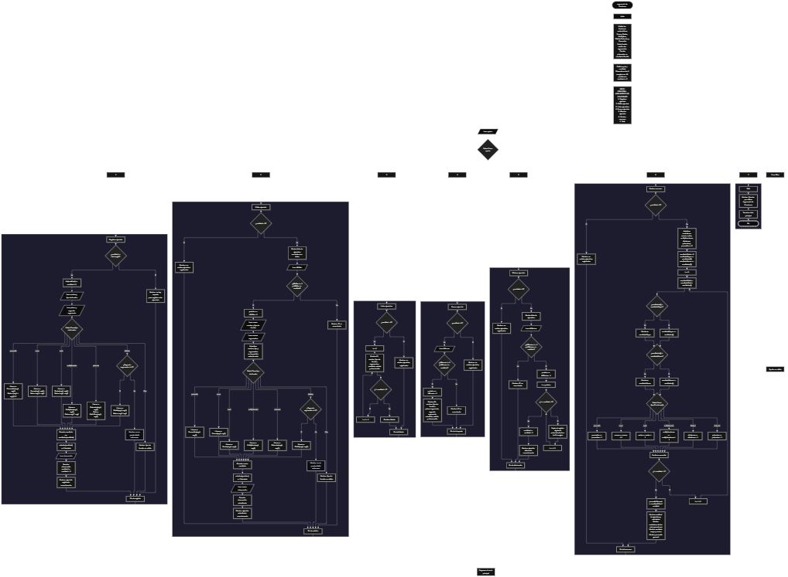

Este proyecto, llamado <b>argumento de funciones</b>, fue desarrollado en <b>visual basic .net</b> como un ejercicio práctico para fortalecer la lógica de programación mediante la creación de un sistema de gestión de ejercicios matemáticos desde la consola. El programa cuenta con un menú principal de siete opciones que permite <b>registrar, editar, eliminar, buscar, listar y consultar el resumen</b> de los ejercicios realizados. Cada ejercicio almacena información como su nombre, tipo de función, dos argumentos, resultado, estado y observación, utilizando arreglos con una capacidad máxima de <b>10 ejercicios durante la ejecución</b>. Para realizar los cálculos se implementaron seis funciones independientes que permiten ejecutar operaciones de suma, resta, multiplicación, división, potencia y promedio, recibiendo dos argumentos de tipo <b>double</b> y devolviendo el resultado correspondiente. Durante su desarrollo se aplicaron conceptos fundamentales de programación, como variables, arreglos, funciones con parámetros, valores de retorno, estructuras condicionales, ciclos repetitivos y estructuras de selección, además de procesos para administrar registros y calcular estadísticas generales.

<h2 align="center">⚙️ Funcionamiento del menú principal</h2>

### ➕ Registrar ejercicio

La opción <b>1) registrar ejercicio</b> permite almacenar un nuevo ejercicio matemático. Antes de realizar el registro, el sistema comprueba que la cantidad de ejercicios almacenados sea menor a la capacidad máxima de los arreglos mediante la condición <b>cantidad &gt;= ids.Length</b>. Si existe espacio disponible, asigna un identificador utilizando la expresión <b>cantidad + 1</b> y solicita el <b>nombre del ejercicio, tipo de función, primer argumento y segundo argumento</b>. Después, utiliza una estructura <b>Select Case</b> para identificar el tipo de operación introducido y llamar a la función correspondiente: <b>Sumar, Restar, Multiplicar, Dividir, Potenciar o Promediar</b>. Cada función recibe los dos argumentos y devuelve un resultado que se almacena en el arreglo <b>resultados</b>. En el caso de la división, comprueba que el segundo argumento sea diferente de cero antes de realizar el cálculo. Si la operación es válida, establece el estado como <b>"Calculado"</b>, solicita una observación, aumenta la variable <b>cantidad</b> en uno y muestra el mensaje <b>"Ejercicio registrado correctamente."</b>. Si se intenta registrar cuando no existe espacio disponible, presenta el mensaje <b>"No hay espacio para registrar mas ejercicios."</b>. Si el tipo de función no es válido o se intenta dividir entre cero, cancela el registro mediante <b>Continue Do</b>.

### ✏️ Editar ejercicio

La opción <b>2) editar ejercicio</b> permite modificar la información de un ejercicio registrado y volver a calcular su resultado. Primero, el programa comprueba si existen ejercicios almacenados mediante la variable <b>cantidad</b>. Si no hay registros, muestra el mensaje <b>"No existen ejercicios registrados."</b>. En caso contrario, presenta una lista con el ID, nombre, tipo de función, argumentos, resultado, estado y observación de cada ejercicio. Después, solicita el ID que se desea editar y comprueba que esté dentro del rango permitido mediante la condición <b>idEditar &gt;= 1 And idEditar &lt;= cantidad</b>. Si la selección es válida, obtiene la posición correspondiente restando uno al identificador y solicita el nuevo nombre, tipo de función y los dos argumentos. A continuación, utiliza <b>Select Case</b> para identificar la operación y llamar a la función matemática correspondiente, actualizando el resultado almacenado. Si se selecciona una división, comprueba que el segundo argumento no sea cero. Cuando el cálculo se realiza correctamente, actualiza el estado a <b>"Calculado"</b>, solicita una nueva observación y muestra el mensaje <b>"Ejercicio actualizado correctamente."</b>. Si el ID no corresponde a un ejercicio registrado, presenta el mensaje <b>"ID no encontrada."</b>. Si el tipo de función no es válido o el divisor es cero, cancela el proceso mediante <b>Continue Do</b>.

### 📋 Listar ejercicios

La opción <b>3) listar ejercicios</b> permite visualizar todos los ejercicios registrados actualmente. Antes de mostrar la información, el programa comprueba si la variable <b>cantidad</b> es igual a cero. Si no existen registros, presenta el mensaje <b>"No existen ejercicios registrados."</b>. Si hay ejercicios disponibles, utiliza un ciclo <b>For</b> para recorrer los arreglos desde la primera posición hasta la última posición ocupada. Durante el recorrido, muestra el ID, nombre, tipo de función, primer argumento, segundo argumento, resultado, estado y observación de cada ejercicio. Esta opción facilita consultar todos los cálculos almacenados sin necesidad de buscar cada ejercicio individualmente.

### 🔎 Buscar ejercicio

La opción <b>4) buscar ejercicio</b> permite localizar un ejercicio mediante su identificador. Primero, el programa comprueba si existen ejercicios registrados. Si no hay información almacenada, muestra el mensaje <b>"No existen ejercicios registrados."</b>. En caso contrario, solicita el ID del ejercicio que se desea buscar y verifica que esté dentro del rango permitido mediante la condición <b>idBuscar &gt;= 1 And idBuscar &lt;= cantidad</b>. Si el identificador es válido, calcula la posición restando uno al ID y muestra toda la información del ejercicio encontrado: <b>nombre, tipo de función, primer argumento, segundo argumento, resultado, estado y observación</b>. Si el ID introducido no corresponde a un ejercicio registrado, presenta el mensaje <b>"ID no encontrada."</b>.

### 🗑️ Eliminar ejercicio

La opción <b>5) eliminar ejercicio</b> permite eliminar un ejercicio registrado mediante su identificador. Antes de comenzar, el programa comprueba que existan ejercicios almacenados. Si no hay registros, muestra el mensaje <b>"No existen ejercicios registrados."</b>. Si existen ejercicios disponibles, presenta una lista con toda su información y solicita el ID del ejercicio que se desea eliminar. Después, comprueba que el identificador esté dentro del rango válido mediante la condición <b>idEliminar &gt;= 1 And idEliminar &lt;= cantidad</b>. Si el ejercicio existe, obtiene su posición restando uno al identificador y utiliza un ciclo <b>For</b> para desplazar una posición hacia atrás los datos de los ejercicios posteriores en los ocho arreglos: <b>ids, nombres, tiposFunciones, primerosArgumentos, segundosArgumentos, resultados, estados y observaciones</b>. Finalmente, disminuye la variable <b>cantidad</b> en uno y muestra el mensaje <b>"Ejercicio eliminado correctamente."</b>. Si el ID seleccionado no corresponde a un ejercicio registrado, presenta el mensaje <b>"ID no encontrada."</b>.

### 📊 Mostrar resumen

La opción <b>6) mostrar resumen</b> permite consultar estadísticas generales de los ejercicios registrados. Primero, el programa comprueba si existen registros mediante la variable <b>cantidad</b>. Si no hay ejercicios, muestra el mensaje <b>"No existen ejercicios registrados."</b>. En caso contrario, inicializa seis contadores para clasificar las operaciones realizadas: <b>sumas, restas, multiplicaciones, divisiones, potencias y promedios</b>. También inicializa las variables <b>resultadoTotal, resultadoMayor y resultadoMenor</b>, utilizando el primer resultado registrado como referencia para determinar el valor máximo y mínimo. Después, recorre los ejercicios mediante un ciclo <b>For</b>, acumula todos los resultados en <b>resultadoTotal</b>, compara cada resultado para actualizar el mayor y el menor, y utiliza una estructura <b>Select Case</b> para incrementar el contador correspondiente al tipo de función. Al finalizar el recorrido, calcula el promedio general mediante la expresión <b>resultadoTotal / cantidad</b>. Finalmente, muestra la cantidad de ejercicios, el total de ejercicios calculados, la cantidad de cada operación, el resultado mayor, el resultado menor y el promedio general.

### 🚪 Salir del menú principal

La opción <b>7) salir</b> está destinada a finalizar la ejecución del programa y muestra el mensaje <b>"Gracias por utilizar Argumento de Funciones."</b>. El menú principal se encuentra dentro de una estructura repetitiva <b>Do...Loop While</b>, que mantiene el programa en funcionamiento mientras la variable <b>opcion</b> sea diferente de <b>7</b>. Cuando el usuario selecciona esta opción, la condición del ciclo se cumple y el programa finaliza correctamente.

<h2 align="center">🧠 Temas aplicados en el proyecto</h2>

### 📦 Variables

En este proyecto se utilizan variables para controlar la opción seleccionada en el menú, administrar la cantidad de ejercicios registrados, recorrer los arreglos, identificar los registros que se desean editar, buscar o eliminar, almacenar los identificadores seleccionados y realizar los cálculos estadísticos. También se utilizan variables dentro de las funciones para recibir los argumentos y devolver los resultados de las operaciones matemáticas. Cada variable cumple una función específica dentro de la ejecución del programa.

🔢 **Opcion:** Almacena la opción seleccionada por el usuario en el menú principal.

📊 **Cantidad:** Controla el número actual de ejercicios registrados.

🔄 **I:** Funciona como contador en los ciclos For y permite recorrer los arreglos.

📍 **Posicion:** Almacena la ubicación del ejercicio que se desea editar, buscar o eliminar.

🆔 **IdEditar:** Almacena el identificador del ejercicio que se desea modificar.

🔎 **IdBuscar:** Almacena el identificador del ejercicio que se desea consultar.

🗑️ **IdEliminar:** Almacena el identificador del ejercicio que se desea eliminar.

➕ **PrimerArgumento y SegundoArgumento:** Representan los dos valores numéricos que reciben las funciones matemáticas.

🧮 **ResultadoTotal:** Acumula los resultados de todos los ejercicios para calcular el promedio general.

📈 **ResultadoMayor y ResultadoMenor:** Almacenan los valores máximo y mínimo encontrados durante el análisis de los resultados.

🔢 **Sumas, Restas, Multiplicaciones, Divisiones, Potencias y Promedios:** Funcionan como contadores para clasificar la cantidad de ejercicios realizados según el tipo de operación.

📊 **PromedioGeneral:** Almacena el promedio de todos los resultados registrados.

### 🗃️ Arreglos

En este proyecto se utilizan ocho arreglos paralelos para almacenar la información de cada ejercicio matemático. Cada arreglo tiene una capacidad de <b>10 posiciones</b> y utiliza el mismo índice para representar los datos correspondientes a un mismo registro. Por ejemplo, la información de un ejercicio almacenado en la posición <b>0</b> se encuentra distribuida entre <b>ids(0), nombres(0), tiposFunciones(0), primerosArgumentos(0), segundosArgumentos(0), resultados(0), estados(0) y observaciones(0)</b>. Esta organización permite registrar, consultar, modificar, mostrar y eliminar ejercicios de manera ordenada.

🆔 **Ids(10):** Almacena los identificadores de los ejercicios registrados.

📝 **Nombres(10):** Guarda los nombres asignados a cada ejercicio.

🎯 **TiposFunciones(10):** Almacena el tipo de operación matemática que se realiza.

🔢 **PrimerosArgumentos(10):** Guarda el primer argumento utilizado en cada operación.

🔢 **SegundosArgumentos(10):** Guarda el segundo argumento utilizado en cada operación.

🧮 **Resultados(10):** Almacena los resultados devueltos por las funciones matemáticas.

📌 **Estados(10):** Guarda el estado de cada ejercicio, establecido como Calculado.

📄 **Observaciones(10):** Almacena las observaciones adicionales de cada ejercicio.

### 🧩 Funciones con parámetros

En este proyecto se implementan seis funciones independientes mediante la estructura <b>Function</b>. Cada función recibe dos parámetros de tipo <b>Double</b>, que representan los argumentos utilizados en la operación matemática, y devuelve un resultado también de tipo <b>Double</b> mediante la instrucción <b>Return</b>. Estas funciones permiten organizar los cálculos en bloques independientes y reutilizables, evitando repetir las operaciones matemáticas directamente dentro de las opciones del menú. Las funciones desarrolladas son <b>Sumar, Restar, Multiplicar, Dividir, Potenciar y Promediar</b>.

➕ **Sumar:** Recibe dos argumentos y devuelve la suma de ambos mediante <b>primerArgumento + segundoArgumento</b>.

➖ **Restar:** Recibe dos argumentos y devuelve la diferencia mediante <b>primerArgumento - segundoArgumento</b>.

✖️ **Multiplicar:** Recibe dos argumentos y devuelve el producto mediante <b>primerArgumento * segundoArgumento</b>.

➗ **Dividir:** Recibe dos argumentos y devuelve el cociente mediante <b>primerArgumento / segundoArgumento</b>.

📐 **Potenciar:** Recibe dos argumentos y utiliza <b>Math.Pow()</b> para elevar el primer argumento a la potencia del segundo.

📊 **Promediar:** Recibe dos argumentos y devuelve el promedio de ambos mediante <b>(primerArgumento + segundoArgumento) / 2</b>.

### ↩️ Argumentos y valores de retorno

Las funciones utilizan parámetros para recibir los valores numéricos enviados desde las opciones de registro y edición. Cuando el programa identifica el tipo de operación mediante <b>Select Case</b>, llama a la función correspondiente y le proporciona los valores almacenados en los arreglos <b>primerosArgumentos</b> y <b>segundosArgumentos</b>. Después de realizar el cálculo, cada función devuelve el resultado mediante <b>Return</b>, permitiendo almacenarlo en la posición correspondiente del arreglo <b>resultados</b>. De esta manera, se aplica el paso de argumentos y la devolución de valores entre el procedimiento principal y las funciones creadas.

### 🔀 Estructuras condicionales

En este proyecto se utiliza la estructura <b>If...Else</b> para comprobar si existe espacio disponible antes de registrar un ejercicio, verificar si hay registros almacenados antes de realizar determinadas operaciones y validar que el ID seleccionado esté dentro del rango permitido. También se utiliza para impedir una división entre cero, comprobando que el segundo argumento sea diferente de <b>0</b>. Estas condiciones permiten controlar el comportamiento del programa según los datos introducidos y el estado de los registros.

### 🔄 Estructuras repetitivas

En este proyecto se utilizan las estructuras repetitivas <b>Do...Loop While</b> y <b>For</b>. El ciclo <b>Do...Loop While</b> mantiene activo el menú principal y permite ejecutar diferentes operaciones hasta que el usuario selecciona la opción <b>7</b>. Por otro lado, los ciclos <b>For</b> permiten recorrer los arreglos para mostrar los ejercicios registrados y reorganizar los datos cuando se elimina un registro. También se utilizan en el resumen estadístico para recorrer los resultados y calcular los contadores, el valor mayor, el valor menor y el promedio general.

### 🎯 Estructura Select Case

El programa utiliza la estructura <b>Select Case</b> para controlar las opciones del menú principal y determinar qué operación debe ejecutarse. Cada caso representa una acción específica: <b>registrar, editar, listar, buscar, eliminar, mostrar resumen o salir</b>. También se utiliza otra estructura <b>Select Case</b> para identificar el tipo de función matemática introducido por el usuario y ejecutar la operación correspondiente. Los tipos permitidos son <b>suma, resta, multiplicacion, division, potencia y promedio</b>. Además, el bloque <b>Case Else</b> permite mostrar un mensaje cuando se introduce una opción o un tipo de función no válido.

### 🔢 Dimensionamiento de arreglos

El programa utiliza la declaración de arreglos con índices desde <b>0 hasta 9</b>, lo que proporciona una capacidad de <b>10 posiciones</b> para almacenar los ejercicios. La propiedad <b>Length</b> permite conocer la capacidad de los arreglos y comprobar si todavía existe espacio disponible antes de registrar un nuevo ejercicio. La variable <b>cantidad</b> controla el número de posiciones ocupadas y permite realizar los recorridos únicamente sobre los registros existentes.

### 🔄 Reorganización de registros

Cuando se elimina un ejercicio, el programa utiliza un ciclo <b>For</b> que comienza en la posición seleccionada y llega hasta <b>cantidad - 2</b>. En cada repetición, los datos de la posición siguiente se copian sobre la posición actual en los ocho arreglos: <b>ids, nombres, tiposFunciones, primerosArgumentos, segundosArgumentos, resultados, estados y observaciones</b>. Después, la variable <b>cantidad</b> disminuye en uno. De esta manera, los registros posteriores ocupan las posiciones disponibles y se mantiene organizada la información almacenada. Sin embargo, los identificadores no se renumeran después de la eliminación.

### 📊 Operaciones estadísticas

En la opción de resumen se aplican operaciones estadísticas mediante variables acumuladoras, contadores y estructuras condicionales. El programa suma los resultados de todos los ejercicios utilizando <b>resultadoTotal</b>, identifica el resultado mayor y menor mediante comparaciones y calcula el promedio general dividiendo el total acumulado entre la cantidad de ejercicios. También utiliza seis contadores para determinar cuántas operaciones de cada tipo se han realizado. Estos procedimientos permiten obtener una visión general de los cálculos registrados durante la ejecución.

<h2 align="center">¿Cómo se implementaron las operaciones crud en el proyecto?</h2>

Las operaciones <b>crud</b> se implementaron mediante las opciones del menú principal, permitiendo administrar los ejercicios matemáticos registrados. La operación <b>crear</b> corresponde a <b>registrar ejercicio</b>, donde se introducen los datos, se identifica el tipo de función y se calcula el resultado; <b>leer</b> se realiza mediante las opciones <b>buscar ejercicio y listar ejercicios</b>, que permiten consultar los registros almacenados; <b>actualizar</b> corresponde a <b>editar ejercicio</b>, donde se modifican los datos y se vuelve a ejecutar la operación matemática; y <b>eliminar</b> se realiza mediante la opción <b>eliminar ejercicio</b>, que reorganiza los arreglos para retirar el registro seleccionado. Adicionalmente, la opción <b>mostrar resumen</b> permite consultar estadísticas generales de los ejercicios. Todas estas operaciones utilizan variables, arreglos, funciones, condicionales y ciclos para gestionar la información temporalmente durante la ejecución del programa.

<h2 align="center">Diagrama de flujo del proyecto</h2>

<h2 align="center">🛡️ Validaciones del programa</h2>

### 📭 No existen ejercicios registrados

Esta validación se utiliza en las opciones de <b>editar, listar, buscar, eliminar y mostrar resumen</b>. El programa comprueba si la variable <b>cantidad</b> es igual a <b>0</b> y, si no existen ejercicios registrados, muestra el mensaje <b>"No existen ejercicios registrados."</b>. Esta comprobación evita continuar con operaciones que necesitan información almacenada cuando todavía no se han registrado ejercicios.

### ⚠️ Capacidad máxima de ejercicios

Esta validación se utiliza durante el registro de nuevos ejercicios para controlar la capacidad de los arreglos. El programa comprueba si <b>cantidad &gt;= ids.Length</b> antes de permitir un nuevo registro. Como los arreglos tienen diez posiciones, se pueden almacenar hasta <b>10 ejercicios</b> durante la ejecución. Si se alcanza esa capacidad, muestra el mensaje <b>"No hay espacio para registrar mas ejercicios."</b>, impidiendo agregar otro registro.

### ❌ Tipo de función no válido

Esta validación se utiliza durante el registro y la edición de ejercicios. El programa compara el tipo de función introducido con las seis operaciones permitidas mediante <b>Select Case</b>. Si el texto no coincide con ninguno de los casos definidos, ejecuta el bloque <b>Case Else</b>, muestra el mensaje <b>"Tipo de funcion no valido."</b> y utiliza <b>Continue Do</b> para cancelar el proceso actual y regresar al menú principal.

### ➗ División entre cero

Esta validación se utiliza cuando el usuario selecciona la operación de división. Antes de llamar a la función <b>Dividir</b>, el programa comprueba que el segundo argumento sea diferente de <b>0</b> mediante la condición <b>segundosArgumentos(cantidad) &lt;&gt; 0</b> durante el registro, o su posición correspondiente durante la edición. Si el divisor es cero, muestra el mensaje <b>"No se puede dividir entre cero."</b> y utiliza <b>Continue Do</b> para cancelar el proceso sin realizar la división.

### 🔢 Identificación de ejercicios

El programa utiliza los identificadores almacenados en el arreglo <b>ids</b> para seleccionar los ejercicios que se desean editar, buscar o eliminar. Antes de realizar estas operaciones, comprueba que el ID introducido sea mayor o igual a <b>1</b> y menor o igual a <b>cantidad</b>. Si el identificador está dentro del rango permitido, obtiene la posición correspondiente mediante la expresión <b>ID - 1</b>. Si el valor no cumple esta condición, muestra el mensaje <b>"ID no encontrada."</b>. Esta forma de selección funciona mientras los identificadores coincidan con las posiciones de los registros.

### 🔄 Reorganización después de eliminar

Durante la eliminación de un ejercicio, el programa desplaza los datos de los registros posteriores una posición hacia atrás en los ocho arreglos y disminuye la variable <b>cantidad</b> en uno. Sin embargo, los identificadores originales no se actualizan. Debido a que las operaciones de búsqueda, edición y eliminación utilizan <b>ID - 1</b> para determinar la posición, después de eliminar un registro intermedio pueden seleccionar una posición incorrecta. Además, al registrar nuevos ejercicios, el identificador se genera nuevamente mediante <b>cantidad + 1</b>, por lo que pueden producirse identificadores duplicados.

### ⚠️ Conversión de datos numéricos

El programa utiliza <b>Convert.ToInt32()</b> para convertir la opción del menú y los identificadores introducidos, y <b>Convert.ToDouble()</b> para convertir los argumentos matemáticos. Estas conversiones permiten trabajar con valores numéricos durante las operaciones. Sin embargo, el código actual no incluye un control de excepciones para entradas que no sean números. Si el usuario introduce texto u otro valor que no pueda convertirse, el programa puede generar un error durante la ejecución.

### ⚠️ Cancelación durante la edición

Durante la edición, el programa actualiza directamente el nombre, el tipo de función y los argumentos antes de comprobar si el tipo de operación es válido y si la división puede realizarse. Por este motivo, si se introduce un tipo de función no válido o un divisor igual a cero, el proceso se cancela mediante <b>Continue Do</b>, pero los nuevos datos ya pueden haber reemplazado los valores anteriores. En estos casos, el resultado, el estado y la observación pueden conservar la información anterior, dejando el registro parcialmente actualizado.

<h2 align="center">🎯 Objetivo del proyecto</h2>

El objetivo principal de este proyecto es fortalecer la <b>lógica de programación</b> mediante el desarrollo de un sistema de gestión de ejercicios matemáticos en <b>visual basic .net</b>. A través de su construcción se busca aplicar los conocimientos adquiridos sobre variables, arreglos, funciones con parámetros, argumentos, valores de retorno, estructuras condicionales, ciclos repetitivos y estructuras de selección, integrándolos para resolver diferentes operaciones matemáticas de manera organizada. Además, el proyecto permite comprender cómo crear funciones reutilizables, enviarles argumentos, recibir resultados y administrar información mediante operaciones de registro, consulta, modificación y eliminación. De esta manera, se establece una base para desarrollar aplicaciones de consola más completas y fortalecer el aprendizaje de la programación modular.

